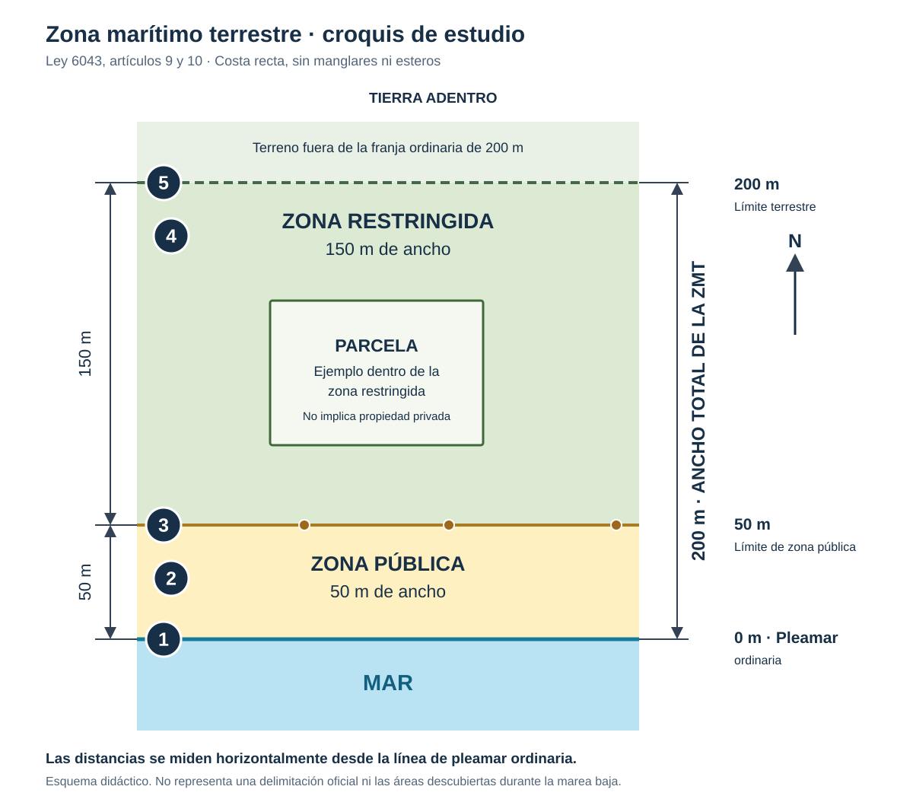

# Avance de estudio: segunda convocatoria de Catastro 2022

Fecha: 25 de octubre de 2026. Estado: preguntas 1–6 explicadas; pendientes 7 y 8. No se ha realizado simulacro ni evaluación completa.

## Método de estudio

Antes de cada respuesta, indicar norma y artículo. Aplicar normativa vigente a la próxima prueba, usando los exámenes anteriores como ejercicios. Distinguir texto legal, aplicación al caso y propuestas didácticas sin clave oficial.

Referencia reglamentaria principal: archivo del usuario “Decreto 45815.pdf”, 110 páginas, versión oficial actualizada a julio de 2026 del Decreto 44647-MJP con reforma del Decreto 45815-JP al artículo 151.

## Pregunta 1: oposición a la calificación

Fundamento: Decreto 44647, artículos 43–45. Actualización de impugnación: Ley 10768 y comunicado DRI-03-0953-2025 del Registro Inmobiliario.

Procede cuando el profesional discrepa de la calificación: debe fundamentar la oposición jurídica o técnicamente, presentarla por el sistema correspondiente y dentro de vigencia del asiento; corregir defectos no recurridos, considerando la excepción normativa sobre visados.

Recorrido del artículo 44: persona registradora → coordinación → persona subdirectora catastral. Son niveles de revisión dentro de la oposición, no tres recursos diferentes.

El ocurso fue eliminado por Ley 10768. Tras la resolución que confirma los defectos procede apelación al Tribunal Registral Administrativo, dentro de cinco días hábiles desde la notificación, con los requisitos de presentación aplicables.

[Comunicado oficial](https://www.colegiotopografoscr.com/comunicados/2025/Nota-figura-del-ocurso.pdf).

## Pregunta 2: proceso sumario

Fundamento: Código Procesal Civil, Ley 9342, artículo 103. Procedimiento abreviado y concentrado para las pretensiones legalmente asignadas; cinco días para contestar y audiencia única cuando corresponde celebrarla.

Ejemplo: interdicto de reposición de linderos, artículos 103.1.3 y 106.4. Si se altera una cerca, el topógrafo puede estudiar antecedentes, medir situación actual, documentar desplazamiento y franja, rendir informe o peritaje y replantear lo ordenado judicialmente. Estas son aplicaciones técnicas, no una lista literal del artículo.

Artículo 106.1: tutela posesión actual y momentánea, no decide propiedad ni posesión definitiva.

Consulta de la estudiante sobre avalúos: artículo 44 regula prueba pericial. Un avalúo puede integrar prueba pertinente en un proceso sumario concreto, pero no es por sí solo un tipo de proceso. Se debe identificar pretensión, objeto de valoración y competencia profesional. Para este examen, reposición de linderos es el ejemplo más directo.

[Artículo 103](https://www.pgrweb.go.cr/DOCS/NORMAS/1/VIGENTE/L/2010-2019/2015-2019/2016/13DD0/10BC0C.HTML).
[Artículo 106](https://www.pgrweb.go.cr/DOCS/NORMAS/1/VIGENTE/L/2010-2019/2015-2019/2016/13DD0/10BC0F.HTML).

## Pregunta 3: trabajos catastrales

Fundamento: Decreto 44647 actualizado, artículo 61. Página 37 del PDF del usuario, numeración impresa 36.

El examen antiguo pide diez actividades; la norma vigente enumera trece. Estudiar la lista completa y aclarar la diferencia:

1. Control geodésico catastral.
2. Fotografía aérea, control fotogramétrico, ortofotos, capas geográficas y mapas fotogramétricos digitales.
3. Levantamientos complementarios.
4. Antecedentes catastrales y registrales.
5. Conciliación jurídica-catastral.
6. Expedientes prediales.
7. Levantamiento y recopilación de información de campo.
8. Mapa y mosaico catastral provisional.
9. Exposición pública y actas de conformidad.
10. Mapa definitivo.
11. Actualización y mantenimiento.
12. Declaratoria de firmeza de datos.
13. Declaratoria de zona catastrada.

Zona catastral: proceso en ejecución. Zona catastrada: levantamiento concluido y oficializado. No confundir las declaratorias.

## Pregunta 4: croquis de ZMT

Fundamento: Ley 6043, artículos 9–10; artículo 11 para manglares y esteros.

[Croquis numerado](zmt_croquis_estudio.svg):

1. Línea de pleamar ordinaria, origen de medición.
2. Zona pública, primeros 50 m.
3. Límite público/restringido, a 50 m de pleamar.
4. Zona restringida, siguientes 150 m.
5. Límite terrestre, a 200 m de pleamar.

Propuesta didáctica de cinco rótulos: el enunciado no fija cuáles deben ser esos cinco. Añadir parcela, mar, norte y cotas. Medición horizontal; no sumar 200 m después de los 50 m públicos. El esquema de costa recta excluye manglares, esteros y la representación de áreas descubiertas en bajamar; no es delimitación oficial. Dibujar parcela no acredita dominio privado.

## Pregunta 5: información posesoria en frontera norte

Caso: Natalia alega 32 años de posesión y antecedentes paternos de 40 años adicionales.

### Respuesta corregida

Suponiendo que el inmueble esté dentro de los 2.000 metros fronterizos y sea terreno público, **no procede titularlo por información posesoria**. La suma de 72 años de ocupación no lo convierte en propiedad privada. No presentar el visado MINAE como autorización para titular terreno público.

Dos elementos normativos:

1. Ley 2825, artículo 7.f: inalienabilidad y exclusión de adquisición por denuncio o posesión en la franja de dos kilómetros; reserva de dominio privado con título legítimo.
2. Ley de Terrenos Baldíos N.º 13 de 1939, artículo 10: antecedente de reserva fronteriza de dos kilómetros. Ver continuidad histórica en los criterios de la PGR.

El artículo 134 del Decreto 44647 exige visado MINAE y cumplimiento de artículos 84 y 86 para planos de la frontera norte, pero no elimina restricciones sustantivas del dominio. Diferenciar registro técnico de un plano y aptitud para titular. Se rectificó la respuesta inicial por dejar demasiado abierta la inscripción del plano destinado a titular un terreno público.

La afectación al Refugio Corredor Fronterizo Norte debe examinarse según delimitación, reformas y régimen concreto. No equiparar sin análisis toda área protegida con idéntico régimen dominial.

### Noticia aportada por la estudiante

El INDER anunció contratos de concesión a 200 familias de frontera sur, 24/09/2026. Se pudo verificar el resumen en el índice institucional; no se abrió el cuerpo completo de la noticia.

Concesión no equivale a propiedad obtenida por información posesoria. Decreto 39688-MAG, artículo 3 y reformas: concesiones de terrenos fronterizos bajo administración del INDER con exclusiones legales. No trasladar automáticamente una concesión del sur al caso del norte, ni afirmar concesionabilidad del Patrimonio Natural del Estado.

Los proyectos legislativos y mociones aportados no prueban por sí solos normativa vigente ni un requisito general de certificación IGN.

[PGR OJ-124-2015](https://www.pgrweb.go.cr/DOCS/DICTAMENES/1/P/J/2010-2019/2015-2019/2015/1085A9.HTML).
[Criterio PGR sobre reserva histórica](https://sinalevi.go.cr/ResultadosPronunciamiento/Informacion?param1=15144&param2=0).
[Reforma 2025 a concesiones fronterizas](https://www.pgrweb.go.cr/DOCS/NORMAS/1/VIGENTE/D/2020-2029/2025-2029/2025/199C9/177EA3.HTML).

## Pregunta 6: hipoteca y patrimonio familiar

Fundamento: Ley 6545, artículo 30.

Respuesta: **sí debe citarse plano catastrado para constituir la hipoteca**. La afectación a patrimonio familiar está exceptuada, pero la constitución hipotecaria no. La excepción se refiere a cancelar hipotecas, no a constituirlas. Si se incluyen ambos actos, se necesita el plano por la hipoteca. No implica necesariamente elaborar plano nuevo: citar el inscrito que corresponda al inmueble y acto.

Excepciones expresas: cancelaciones hipotecarias, afectación a patrimonio familiar y embargo.

## Próximo punto

Continuar con **pregunta 7 de II-2022: sanciones profesionales del CFIA**. Verificar primero el Código de Ética vigente y distinguir disciplina profesional de sanción penal. El enunciado antiguo menciona tres penas; no asumir que ese número corresponda al texto actual.

Después, pregunta 8: inscripción provisional y cuatro ejemplos, con artículo 151 reformado por Decreto 45815.

## Fuente reglamentaria consolidada

[Registro Nacional, versión julio de 2026](https://www.rnpdigital.com/centroinforegistral/registros/inmobiliario/bi_normativa/DECRETO%2044647%20REGLAMENTO%20GENERAL%20DEL%20REGISTRO%20INMOBILIARIO.pdf).

Material de estudio, sin clave oficial del jurado. Comprobar reformas aplicables a la fecha de la prueba.
